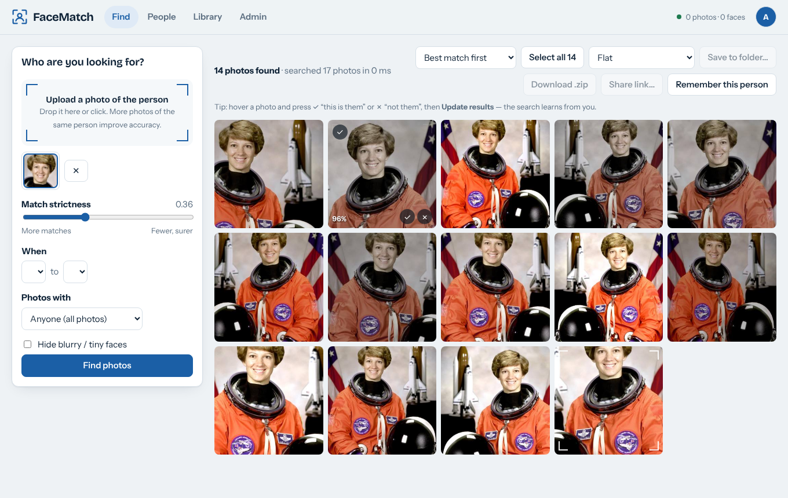
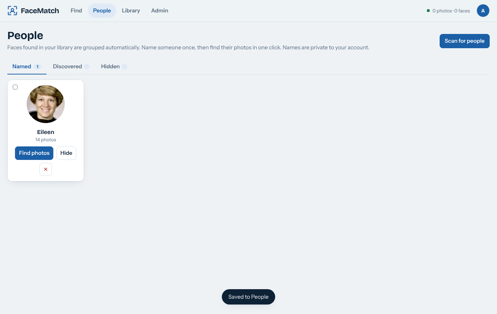
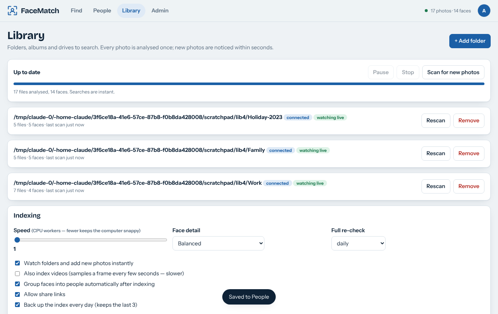
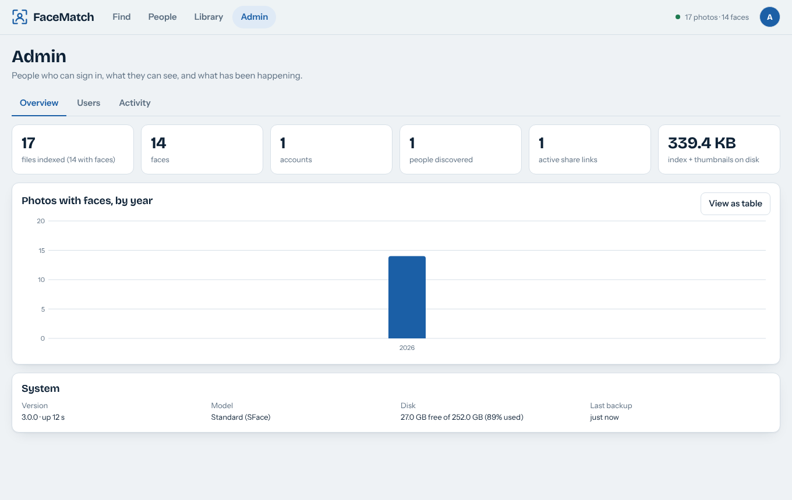
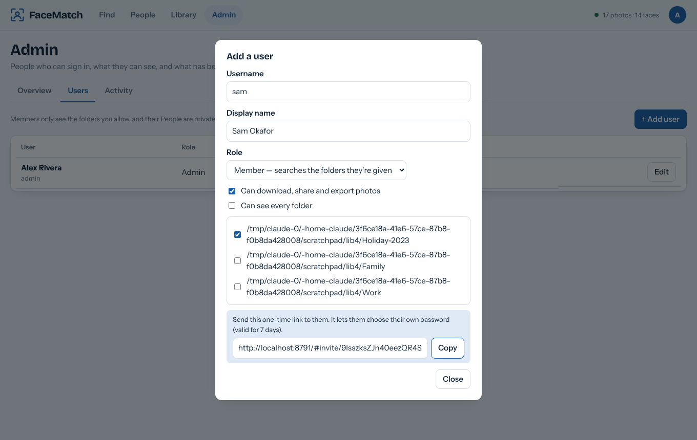
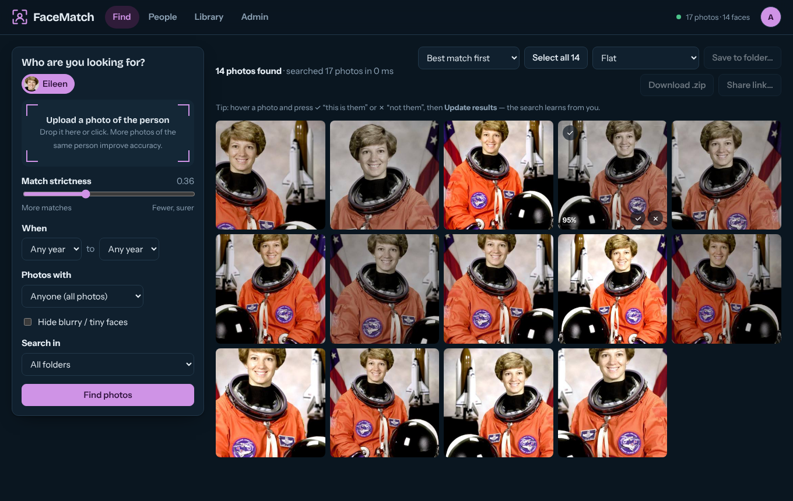
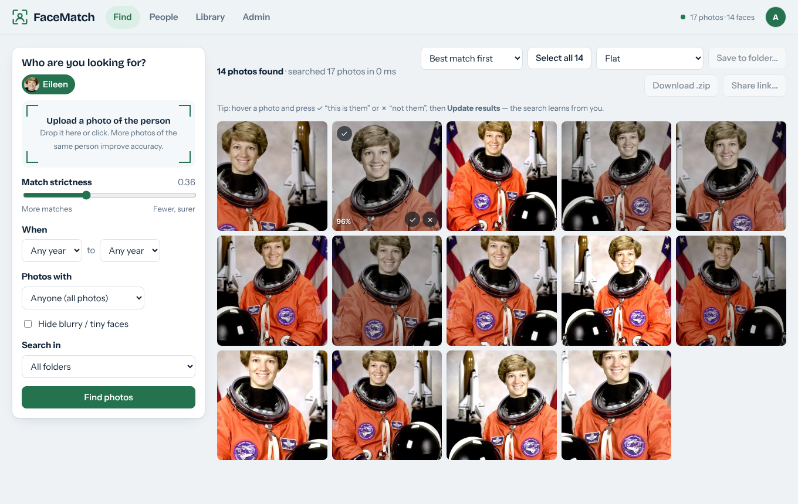
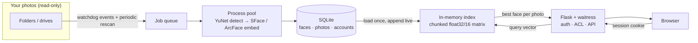

<div align="center">

# FaceMatch

**Find anyone in thousands of photos — privately, on your own computer.**

Upload a face (or pick a person), and FaceMatch shows every photo they appear in across your folders, albums and external drives.
Everything runs locally; your pictures never leave your machine.

[](https://github.com/Gauranshh/facematch/actions/workflows/ci.yml)




</div>

## Why it exists

Most photo libraries are a pile of folders. Finding "every picture of Mum" means scrolling for an evening. FaceMatch analyses each photo **once**,
keeps a compact index on disk, and from then on every search is instant — whether you have 100 photos or 2 TB.

## Features

| | |
|---|---|
| **Instant search** | Index once; each search takes milliseconds. Face grouping benchmarked on 240,000 synthetic faces. |
| **Accounts** | Admin and member roles, invite links, per-folder access, view-only members, audit log. Each person's named people are private. |
| **Instant new-photo detection** | A filesystem watcher indexes photos the moment they are copied in (polling fallback for network drives). |
| **People** | Faces are grouped automatically; name someone once and find their photos in one click. Search two people together. |
| **Learns from you** | Mark results "this is them / not them" and the search sharpens — permanently for saved people. |
| **Filters** | Year, solo shots vs. groups, folder, hide blurry faces, include videos (frame sampling). |
| **Share & export** | Expiring, revocable share links with a public viewer; streaming `.zip` download; copy to a folder (flat / by year / original structure). |
| **Two models** | Fast SFace by default; optional ArcFace for harder cases (children, side views, ageing). Switching carries your people over. |
| **Themes** | Six accent palettes × light / dark / auto, remembered per account. Installable as an app (PWA). |
| **Safe at scale** | Background multi-process indexing, resumable, pausable, never touches your originals. Daily index backups. |

<table>
<tr><td></td><td></td></tr>
<tr><td></td><td></td></tr>
<tr><td></td><td></td></tr>
</table>

## Quick start

**Windows** — double-click `start.bat`. **macOS / Linux** — `./start.sh`. Both create a virtual environment, install dependencies,
download the small face models (~39 MB) and open <http://localhost:8765>. The first screen creates the admin account.

```bash
# or by hand
python -m venv .venv && . .venv/bin/activate      # Windows: .venv\Scripts\activate
pip install -r requirements.txt
python run.py
```

Then: **Library → Add folder**, wait for the first scan, and go to **Find**.

### Docker

```bash
# edit the two volume paths in docker-compose.yml, then
docker compose up -d
docker compose logs facematch      # shows the one-time setup code if you open it from another device
```

Mount your photos read-only (`/photos`) and add `/photos` as a folder in the Library tab.

### Run as a service (Linux)
See [`facematch.service`](facematch.service). Set `FACEMATCH_ADMIN_USER` / `FACEMATCH_ADMIN_PASSWORD` to skip the setup screen on unattended installs.

## Letting other people in

1. **Admin → Users → Add user**, choose which folders they may see, and copy their invite link to them.
2. They open the link, pick a password, and see only their folders. Their named people and share links are theirs alone.
3. To reach the site from other devices: `FACEMATCH_HOST=0.0.0.0`, and put HTTPS in front ([`Caddyfile.example`](Caddyfile.example)) with `FACEMATCH_TRUST_PROXY=1`.

## How it works



* **Detection and recognition** use OpenCV's YuNet detector and SFace (128-d) or ArcFace (512-d) embeddings on the CPU — no GPU, no cloud.
* **Search** is a matrix–vector product over all stored faces (in 100k-face chunks) followed by a per-photo best match, with feedback folded in as
  a Rocchio-style positive centroid and a negative penalty. Folder permissions are applied *inside* the query, so a member's search cannot reach other folders.
* **Indexing** is incremental (size + mtime), uses low-priority worker processes, commits in batches, and decodes JPEGs at reduced size for speed.
* **People discovery** clusters faces greedily by quality, merges near-duplicate groups, and stores results in a shared pool; each user claims groups into their own private list.

## Configuration

| Variable | Default | Meaning |
|---|---|---|
| `FACEMATCH_DATA` | `~/.facematch` | Where the index, thumbnails, accounts and logs live |
| `FACEMATCH_HOST` / `FACEMATCH_PORT` | `127.0.0.1` / `8765` | Listen address |
| `FACEMATCH_ADMIN_USER` / `FACEMATCH_ADMIN_PASSWORD` | – | Create the first admin from the environment (unattended installs) |
| `FACEMATCH_TRUST_PROXY` | – | Set to `1` behind an HTTPS reverse proxy |
| `FACEMATCH_NO_BROWSER` | – | Don't open a browser on start |

Command line (headless servers): `python cli.py add ~/Pictures`, `python cli.py find --face me.jpg --out ./me`.

## Privacy, security and the law

* Everything stays on your machine. The only network use is downloading the models.
* Face embeddings are **biometric data**. Many places (GDPR, Illinois BIPA, and others) require consent from the people in your photos
  when you process their faces, especially if you run this for other people or an organisation. You are responsible for lawful use.
* Security design and limits are described in [SECURITY.md](SECURITY.md). Report vulnerabilities privately.

## Development

```bash
pip install -r requirements.txt -r requirements-dev.txt
python download_models.py
ruff check . && python -m pytest        # 23 tests: auth, folder isolation, shares, live detection, clustering
```

CI runs the suite on Linux, Windows and macOS and builds the Docker image. See [CONTRIBUTING.md](CONTRIBUTING.md).

## Credits

* [OpenCV Zoo](https://github.com/opencv/opencv_zoo) — YuNet and SFace models; [InsightFace](https://github.com/deepinsight/insightface) — optional ArcFace model (non-commercial research licence — check it before commercial use).
* Fonts: Bricolage Grotesque and Instrument Sans (SIL OFL, in `static/fonts`).
* Screenshots use the public-domain NASA portrait bundled with scikit-image.

Built by Gauransh. MIT licensed.
